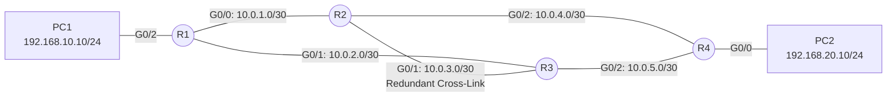
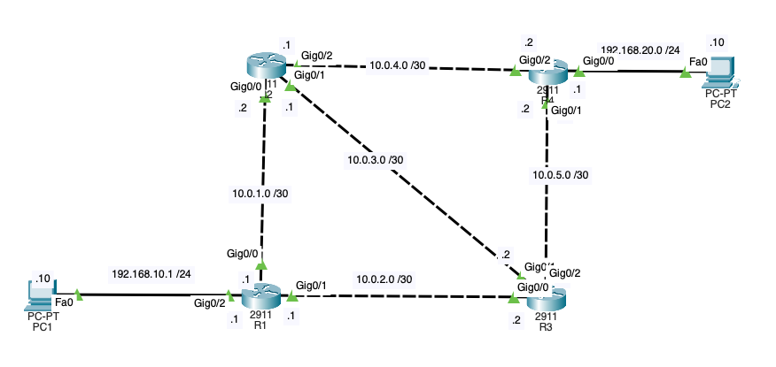
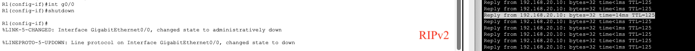
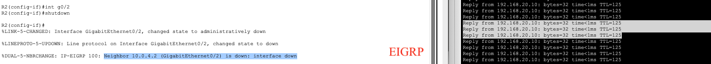

# ripv2-vs-eigrp-failover-lab
Comparative analysis of RIPv2 and EIGRP convergence, metrics, and failover behavior in a redundant 4-router diamond topology.

# RIPv2 vs. EIGRP Failover & Convergence Lab


> **Executive Summary:** Built and benchmarked a redundant 4-router diamond network in Cisco Packet Tracer to compare distance-vector (**RIPv2**) and hybrid (**EIGRP**) dynamic routing protocols. Simulated link failures under active ICMP traffic to measure convergence times, route recalculation behavior, and metric selection across equal-cost paths.

---

## Network Topology

The lab uses a redundant diamond topology with a cross-link (`10.0.3.0/30`) between **R2** and **R3** to eliminate single points of failure between **PC1** and **PC2**.



---

## IP Addressing Plan

All point-to-point router links use `/30` subnets (`255.255.255.252`) to conserve address space, while end-host LANs use `/24` subnets (`255.255.255.0`).

| Device | Interface | IP Address | Subnet Mask | Connected Peer / Role |
| :--- | :--- | :--- | :--- | :--- |
| **PC1** | `FastEthernet0` | `192.168.10.10` | `255.255.255.0` | Gateway: `192.168.10.1` |
| **R1** | `GigabitEthernet0/2` | `192.168.10.1` | `255.255.255.0` | LAN Gateway (PC1) |
| **R1** | `GigabitEthernet0/0` | `10.0.1.1` | `255.255.255.252` | R2 (`G0/0` - `10.0.1.2`) |
| **R1** | `GigabitEthernet0/1` | `10.0.2.1` | `255.255.255.252` | R3 (`G0/0` - `10.0.2.2`) |
| **R2** | `GigabitEthernet0/0` | `10.0.1.2` | `255.255.255.252` | R1 (`G0/0` - `10.0.1.1`) |
| **R2** | `GigabitEthernet0/1` | `10.0.3.1` | `255.255.255.252` | R3 (`G0/1` - `10.0.3.2`) |
| **R2** | `GigabitEthernet0/2` | `10.0.4.1` | `255.255.255.252` | R4 (`G0/2` - `10.0.4.2`) |
| **R3** | `GigabitEthernet0/0` | `10.0.2.2` | `255.255.255.252` | R1 (`G0/1` - `10.0.2.1`) |
| **R3** | `GigabitEthernet0/1` | `10.0.3.2` | `255.255.255.252` | R2 (`G0/1` - `10.0.3.1`) |
| **R3** | `GigabitEthernet0/2` | `10.0.5.1` | `255.255.255.252` | R4 (`G0/1` - `10.0.5.2`) |
| **R4** | `GigabitEthernet0/2` | `10.0.4.2` | `255.255.255.252` | R2 (`G0/2` - `10.0.4.1`) |
| **R4** | `GigabitEthernet0/1` | `10.0.5.2` | `255.255.255.252` | R3 (`G0/2` - `10.0.5.1`) |
| **R4** | `GigabitEthernet0/0` | `192.168.20.1` | `255.255.255.0` | LAN Gateway (PC2) |
| **PC2** | `FastEthernet0` | `192.168.20.10` | `255.255.255.0` | Gateway: `192.168.20.1` |

---

## Repository Structure

```text
├── packet-tracer/
│   ├── ripv2-failover-lab.pkt       # Saved topology running RIPv2
│   └── eigrp-failover-lab.pkt       # Saved topology running EIGRP AS 100
├── configs/
│   ├── ripv2/                       # Sanitized running-configs for R1–R4 (RIPv2)
│   └── eigrp/                       # Sanitized running-configs for R1–R4 (EIGRP)
├── docs/
│   ├── 01-failover-analysis.md      # Detailed timer & packet-loss observations
│   └── images/                      # Screenshots of Packet Tracer & ping tests
└── README.md
```

---

## Protocol Comparison: RIPv2 vs. EIGRP

| Feature / Behavior | RIPv2 | EIGRP (AS 100) |
| :--- | :--- | :--- |
| **Protocol Type** | Distance Vector (Bellman-Ford) | Advanced Distance Vector / Hybrid (DUAL) |
| **Administrative Distance** | `120` | `90` (Internal) / `170` (External) |
| **Metric Type** | **Hop Count** only (treats 10 Mbps and 10 Gbps links identically) | **Composite Metric** (Bandwidth + Delay by default) |
| **Maximum Hop Limit** | **15 hops** (`16` = unreachable / infinity) | **100 hops** default (configurable up to `255`) |
| **Routing Updates** | Periodic full-table updates every **30 seconds** (`224.0.0.9`) | Event-driven **incremental/bounded** updates (`224.0.0.10`); 5s Hellos |
| **Convergence Behaviour** | **Slow** on remote link failure (up to **180s** Invalid + **240s** Flush timers) | **Sub-second** failover via DUAL pre-calculated **Feasible Successors** |
| **Routes Shown on R1** | `R 192.168.20.0/24 [120/2]` via `10.0.1.2` & `10.0.2.2` | `D 192.168.20.0/24 [90/3328]` via `10.0.1.2` & `10.0.2.2` |

---

## Proof of Work & Validation

### 1. Topology & Baseline End-to-End Connectivity

*Annotated Packet Tracer workspace showing active interfaces (green link indicators) and baseline `tracert 192.168.20.10` from PC1 confirming a 3-hop path across the diamond network.*

### 2. Failover Benchmark: RIPv2 vs. EIGRP Convergence


*Side-by-side Command Prompt output from **PC1** (`ping -t 192.168.20.10`) when shutting down interface `G0/2` on **R2** (the R2–R4 link):*
* **RIPv2:** Experienced prolonged `Request timed out` intervals while waiting for RIP's holddown/flush timers to expire before removing `10.0.1.2` from R1's routing table.
* **EIGRP (AS 100):** Converged in **under 1 second** (0–1 dropped ICMP packets) because DUAL immediately switched traffic to the pre-calculated **Feasible Successor** path via **R3** (`10.0.2.2`).

### 3. Routing & Topology Table Verification

<details>
<summary>Click to view RIPv2 Configuration & R1 Routing Table</summary>

```ios
! R1 RIPv2 Configuration
router rip
 version 2
 no auto-summary
 network 192.168.10.0
 network 10.0.0.0
```

```text
R1# show ip route
Codes: C - connected, S - static, R - RIP, M - mobile, B - BGP
       D - EIGRP, EX - EIGRP external, O - OSPF

      10.0.0.0/8 is variably subnetted, 8 subnets, 2 masks
C        10.0.1.0/30 is directly connected, GigabitEthernet0/0
C        10.0.2.0/30 is directly connected, GigabitEthernet0/1
R        10.0.3.0/30 [120/1] via 10.0.1.2, 00:00:14, GigabitEthernet0/0
                     [120/1] via 10.0.2.2, 00:00:19, GigabitEthernet0/1
R        10.0.4.0/30 [120/1] via 10.0.1.2, 00:00:14, GigabitEthernet0/0
R        10.0.5.0/30 [120/1] via 10.0.2.2, 00:00:19, GigabitEthernet0/1
C     192.168.10.0/24 is directly connected, GigabitEthernet0/2
R     192.168.20.0/24 [120/2] via 10.0.1.2, 00:00:14, GigabitEthernet0/0
                      [120/2] via 10.0.2.2, 00:00:19, GigabitEthernet0/1
```
</details>

<details>
<summary>Click to view EIGRP Configuration, Routing Table & DUAL Topology</summary>

```ios
! R1 EIGRP Configuration
router eigrp 100
 no auto-summary
 network 192.168.10.0 0.0.0.255
 network 10.0.1.0 0.0.0.3
 network 10.0.2.0 0.0.0.3
```

```text
R1# show ip route
      10.0.0.0/8 is variably subnetted, 8 subnets, 2 masks
C        10.0.1.0/30 is directly connected, GigabitEthernet0/0
C        10.0.2.0/30 is directly connected, GigabitEthernet0/1
D        10.0.3.0/30 [90/3072] via 10.0.1.2, 00:04:12, GigabitEthernet0/0
                     [90/3072] via 10.0.2.2, 00:04:12, GigabitEthernet0/1
D        10.0.4.0/30 [90/3072] via 10.0.1.2, 00:04:12, GigabitEthernet0/0
D        10.0.5.0/30 [90/3072] via 10.0.2.2, 00:04:12, GigabitEthernet0/1
C     192.168.10.0/24 is directly connected, GigabitEthernet0/2
D     192.168.20.0/24 [90/3328] via 10.0.1.2, 00:04:12, GigabitEthernet0/0
                      [90/3328] via 10.0.2.2, 00:04:12, GigabitEthernet0/1
```

```text
R1# show ip eigrp topology
P 192.168.20.0/24, 2 successors, FD is 3328
        via 10.0.1.2 (3328/3072), GigabitEthernet0/0
        via 10.0.2.2 (3328/3072), GigabitEthernet0/1
```
</details>

---

## Failover Test Results & Observations

1. **Baseline Connectivity:** `tracert 192.168.20.10` from **PC1** confirmed 3 router hops (`192.168.10.1` → `10.0.1.2` → `10.0.4.2` → `192.168.20.10`).
2. **RIPv2 Link Failure (`shutdown` on R2 `G0/2`):**
   * While running `ping -t 192.168.20.10` from PC1, shutting down the remote R2–R4 link caused intermittent packet drops until RIP's holddown/flush timers expired and R1 removed `10.0.1.2` as a valid path to `192.168.20.0/24`.
3. **EIGRP Link Failure (`shutdown` on R2 `G0/2`):**
   * Repeating the exact same `shutdown` test under EIGRP resulted in **near-instantaneous convergence (0–1 dropped ICMP packets)**. Because DUAL already held the R3 path (`10.0.2.2`) in the EIGRP topology table as a **Feasible Successor**, R1 switched traffic immediately without waiting for timers to expire.
